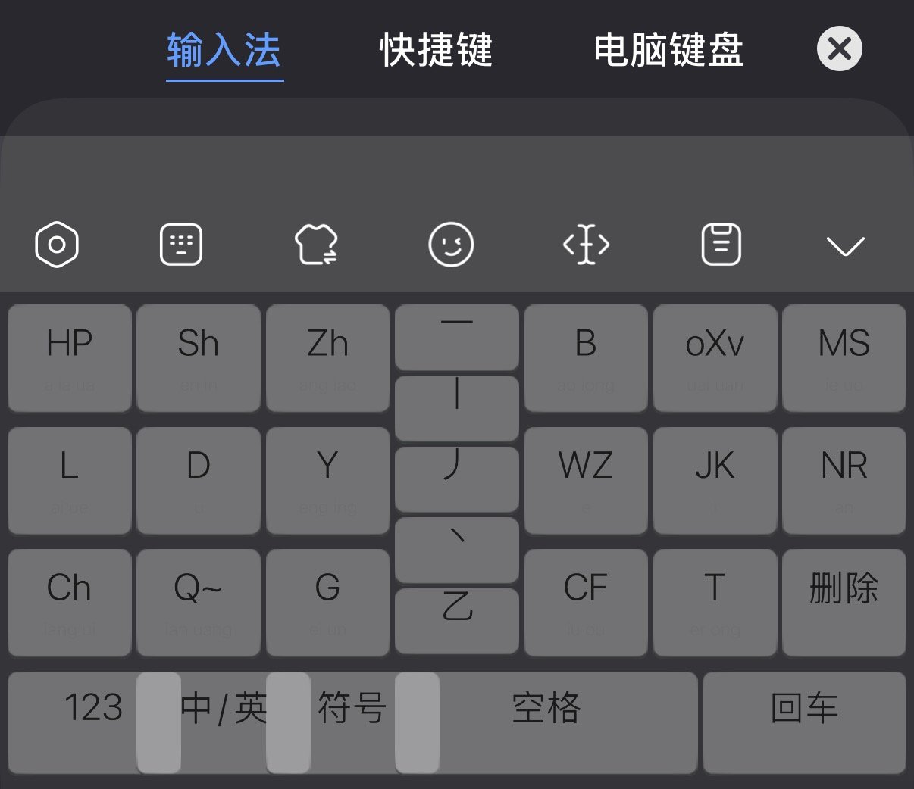

# 乱序17 24键（iOS 手心输入法）

一个 iOS 上能**一键按笔画筛选候选**的乱序17双拼键盘。

据我所知，这是目前唯一一个把笔画筛选做进主键盘的 iOS 乱序17方案。百度输入法 iOS 的笔画筛选锁在「展开候选」面板里，皮肤碰不到；安卓百度有「全键筛选模式」，一步就能按，但 iOS 没有这个开关。这个皮肤靠手心输入法的皮肤系统绕过去了。



## 这是什么

- **24 键布局**：左 9 键、中间 5 个独立笔画键、右 8 键加删除，底部功能行
- **乱序17 双拼**：17 个字母键，声母韵母共键，方案表见下
- **一键笔画筛选**：打完双拼，点中间的「一丨丿丶乛」，候选立即按首笔收窄，双拼编码不变，不会变成三拼
- **上下滑出符号**：字母键上滑出数字和符号，键面直接显示
- **深浅两套**：跟随系统深色模式

## 原理

手心输入法的皮肤用 `skin.json` 描述键盘，每个键的 `values` 决定它发送什么：

```json
{"rect": [[8,10],[96,88]], "values": [0, "1", 4, "h"]}
```

`0` 是上滑，`4` 是点击。笔画键写成 `[4, "一"]`，手心会把「一」写进输入串，再用它筛候选，所以这是内核本来就支持的笔画筛选，不是皮肤模拟出来的。

十七键双拼常见的做法是让按键发字母、由方案翻译成声母韵母；这里多一步，把笔画字符也当成输入，于是筛选和双拼能同时存在。

## 安装

1. App Store 装「手心输入法」
2. 设置里键盘布局选 **26 键**（皮肤挂在 26 键拼音面板上）
3. 皮肤管理里导入 `乱序17_24键.sxi`
4. 双拼方案选「自定义」，把 `手心双拼方案_乱序17.txt` 的内容粘贴进去
5. 切到手心输入法，用中间五个笔画键试

## 双拼方案

`手心双拼方案_乱序17.txt` 全文如下：

```
[声母]
b=B  p=H  m=M  f=F  d=D  t=T  n=N  l=L  g=G  k=J  h=H  j=J  q=Q  x=X
zh=Z  ch=C  sh=S  r=N  z=W  c=F  s=M  y=Y  w=W

[韵母]
a=H  o=X  e=W  i=J  u=D  v=X
ai=L  ei=G  ao=B  ou=F  an=N  en=S  ang=Z  eng=Y  er=T  ong=T
ia=H  ie=M  iao=Z  iu=F  ian=Q  in=S  iang=C  ing=Y  iong=B
ua=H  uo=M  uai=X  ui=C  uan=X  uang=Q  ue=L  un=G

[零声母拼音]
a=QH  ai=QL  an=QN  ang=QZ  ao=QB  e=QW  ei=QG  en=QS  eng=QY  er=QT  o=QX  ou=QF

```

对照检查几个码：你 = NJ，好 = HB，中 = ZT，国 = GM，天 = TQ，今 = JS，爱 = QL。

## 键盘布局

```
HP  Sh  Zh  ┌一┐  B   X   MS
L   D   Y   │丨│  WZ  JK  NR
Ch  Q~  G   │丿│  CF  T   删除
            │丶│
            │乛│
123 ～ EN 空格 ， 回车
```

中间五格是一条连续长条，没有缝，左右两边紧贴字母键。

## 参数调整

`tools_editor.py` 是一个本地网页编辑器，不是必须的，想改宽窄字号颜色才用：

```
pip install 无依赖，直接用 python 跑：
python tools_editor.py
浏览器打开 http://127.0.0.1:8778
```

能调外边距、侧键宽、笔画列宽、键间距、行高、底排键宽、回车宽、字号、字重、深浅两套文字色、笔画条颜色，改完点「生成皮肤文件」会重新生成 `.sxi`。

## 已知限制

- 只对手心输入法 iOS 有效，其它输入法不认这套皮肤
- 皮肤挂在 26 键拼音面板上，输入法里必须选 26 键布局
- 笔画筛选的识别依赖手心对一丨丿丶乛这五个字符的处理，手心改版可能失效
- 没有候选栏、状态栏的深度定制，那些还是手心自带的样式
- 数字页、符号页、英文页只做了少量改动，不是全定制

## 许可

MIT。方案和皮肤随便改随便发，出问题自己担。

